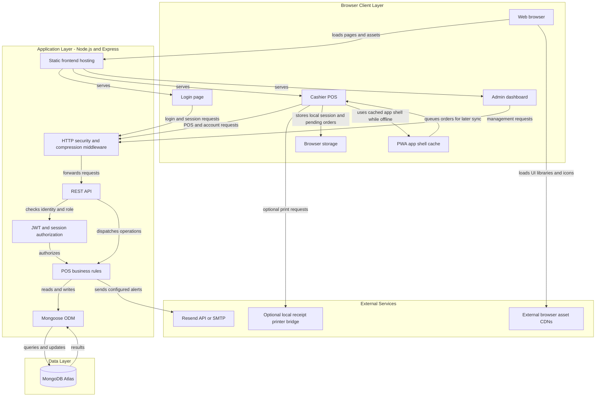

# Architecture Diagram

Season 3 POS is an installable browser-based point-of-sale application backed by a single Node.js service. The service hosts the web pages and REST API, persists operational data in MongoDB Atlas, and can send owner alerts through a configured email provider.

## Application Architecture

<!-- mermaid-checked: no \n, no em-dash/en-dash, no {} in labels, subgraphs are id["label"], arrows are -->|"label"|, all subgraphs closed by end, ids unique -->

### Technology Stack Summary

| Layer | Technology | Version | Purpose |
|---|---|---|---|
| Frontend | HTML, CSS, browser JavaScript | No build step declared | Login, cashier POS, and admin dashboard |
| Frontend libraries | Chart.js, ExcelJS, Font Awesome | Loaded from CDNs | Charts, spreadsheet export, and icons |
| Frontend offline support | Installable PWA, service worker, and browser storage | Browser APIs | Cache app shell and queue cashier orders locally |
| Runtime | Node.js | Node 18+ documented; Render selects runtime | Hosts the backend application |
| Web/API | Express | 5.2.1 | Serves frontend files and REST endpoints |
| Data access | Mongoose | 9.7.1 | MongoDB schemas, indexes, and queries |
| Authentication | jsonwebtoken and bcryptjs | 9.0.3 and 3.0.2 | Signed sessions and password hashing |
| HTTP middleware | Helmet, compression, cors, express-rate-limit | 8.3.0, 1.8.1, 2.8.6, 8.6.2 | Security headers, response compression, CORS policy, and rate limits |
| Configuration | dotenv | 17.4.2 | Loads backend environment configuration |
| Email | Nodemailer or built-in fetch to Resend | 10.0.16 for Nodemailer | Optional owner alerts and daily summaries |
| Database | MongoDB Atlas | Managed service | Stores orders, users, sessions, products, inventory, waste, audit logs, and settings |

### Data Storage & External Services

MongoDB Atlas is the persistent data store; Mongoose models cover orders, products, users, sessions, inventory items, waste records, audit logs, categories, and owner alert settings. The root-scoped PWA service worker caches application entry pages and assets, while the cashier retains local offline order queuing and synchronization through the REST API when connectivity returns. Optional owner email is sent through Resend over HTTPS or SMTP through Nodemailer. Cashier printing can use the browser print dialog or an optional local printer bridge. Browser libraries and icons are loaded from external CDNs.

### Key Architectural Decisions

- One Express process serves both the static frontend and same-origin REST API; the UI is organized as separate login, cashier, and admin pages.
- JWTs are checked against persisted session records, allowing server-side revocation and role-based authorization.
- Order validation, stock deductions, linked supply tracking, and offline retry idempotency are handled by the API before persistence.

## Component Relationships

```mermaid
flowchart LR
    subgraph cPresentation["Presentation"]
        cLogin["Login page"]
        cCashier["Cashier POS"]
        cAdmin["Admin dashboard"]
        cAccount["Shared account and sessions UI"]
        cAdminModules["Admin feature modules"]
        cCashierLogic["Cashier order and offline logic"]
        cApiClient["Frontend API utilities"]
    end
    subgraph cBusiness["Business Logic"]
        cAuthRoutes["Authentication and session routes"]
        cOrderRoutes["Order and stock routes"]
        cCatalogRoutes["Product and category routes"]
        cOpsRoutes["User inventory waste and audit routes"]
        cInsightRoutes["Insights and settings routes"]
        cDomain["Validation and POS domain rules"]
        cAlertLogic["Owner alert logic"]
    end
    subgraph cDataAccess["Data Access"]
        cModels["Mongoose data models"]
        cMongo[("MongoDB Atlas collections")]
    end
    subgraph cInfrastructure["Infrastructure"]
        cMiddleware["Express security and request middleware"]
        cAuth["JWT role and session middleware"]
        cMail["Email transport adapter"]
        cStatic["Express static hosting"]
    end

    cLogin -->|"submits credentials"| cApiClient
    cCashier -->|"orders and account actions"| cApiClient
    cAdmin -->|"management actions"| cAdminModules
    cAdminModules -->|"loads and updates data"| cApiClient
    cCashier -->|"runs checkout and offline sync"| cCashierLogic
    cCashierLogic -->|"calls REST API"| cApiClient
    cAccount -->|"manages sessions and password"| cApiClient
    cApiClient -->|"HTTP requests"| cMiddleware
    cMiddleware -->|"routes requests"| cAuth
    cAuth -->|"protects"| cAuthRoutes
    cAuth -->|"protects"| cOrderRoutes
    cAuth -->|"protects"| cCatalogRoutes
    cAuth -->|"protects"| cOpsRoutes
    cAuth -->|"protects"| cInsightRoutes
    cAuthRoutes -->|"uses"| cDomain
    cOrderRoutes -->|"validates totals and stock"| cDomain
    cCatalogRoutes -->|"validates catalog changes"| cDomain
    cOpsRoutes -->|"applies business rules"| cDomain
    cInsightRoutes -->|"computes reports and settings"| cDomain
    cDomain -->|"queries and updates"| cModels
    cAlertLogic -->|"reads alert settings"| cModels
    cOrderRoutes -->|"triggers low stock alerts"| cAlertLogic
    cAlertLogic -->|"delivers messages"| cMail
    cModels -->|"persists documents"| cMongo
    cStatic -->|"serves browser pages"| cLogin
    cStatic -->|"serves browser pages"| cCashier
    cStatic -->|"serves browser pages"| cAdmin
```

<!-- mermaid-checked: no \n, no em-dash/en-dash, no {} in labels, subgraphs are id["label"], arrows are -->|"label"|, all subgraphs closed by end, ids unique -->

### Component Inventory

| Component | Layer | Type | Responsibility |
|---|---|---|---|
| Login page | Presentation | Browser page | Collects credentials, calls login API, and routes users by role |
| Cashier POS | Presentation | Browser application | Builds orders, handles payment entry, history, and cashier actions |
| Cashier order and offline logic | Presentation | Browser module | Manages checkout state, local offline queue, and retry synchronization |
| Admin dashboard | Presentation | Browser application | Hosts administrator and manager views |
| Admin feature modules | Presentation | Browser modules | Manage dashboard, products, categories, users, inventory, waste, audit, and settings |
| Shared account and sessions UI | Presentation | Browser module | Shows active sessions and supports password and session management |
| Frontend API utilities | Presentation | Browser utility | Adds auth tokens and sends requests to the same-origin API |
| Authentication and session routes | Business Logic | Express routes | Login, validate sessions, revoke sessions, and change passwords |
| Order and stock routes | Business Logic | Express routes | Create, list, void, and refund orders while maintaining stock |
| Product and category routes | Business Logic | Express routes | Maintain menu products and categories |
| User inventory waste and audit routes | Business Logic | Express routes | Manage staff accounts, supplies, waste entries, and audit records |
| Insights and settings routes | Business Logic | Express routes | Serve analytics and manage sales targets and alert preferences |
| Validation and POS domain rules | Business Logic | Domain logic | Normalize inputs, enforce role and stock rules, and calculate order data |
| Owner alert logic | Business Logic | Notification service | Deduplicate and send low-stock and daily sales notifications |
| Mongoose data models | Data Access | ODM models | Define schemas and indexes and perform database operations |
| MongoDB Atlas collections | Data Access | Document database | Persist operational and configuration data |
| Express security and request middleware | Infrastructure | Middleware | Apply security headers, compression, CORS, body parsing, rate limits, and request logging |
| JWT role and session middleware | Infrastructure | Authentication middleware | Verify tokens, persisted sessions, user status, and allowed roles |
| Email transport adapter | Infrastructure | Integration adapter | Deliver mail through Resend or SMTP |
| Express static hosting | Infrastructure | Static file server | Serves the login, cashier, and admin frontend from the same service |
