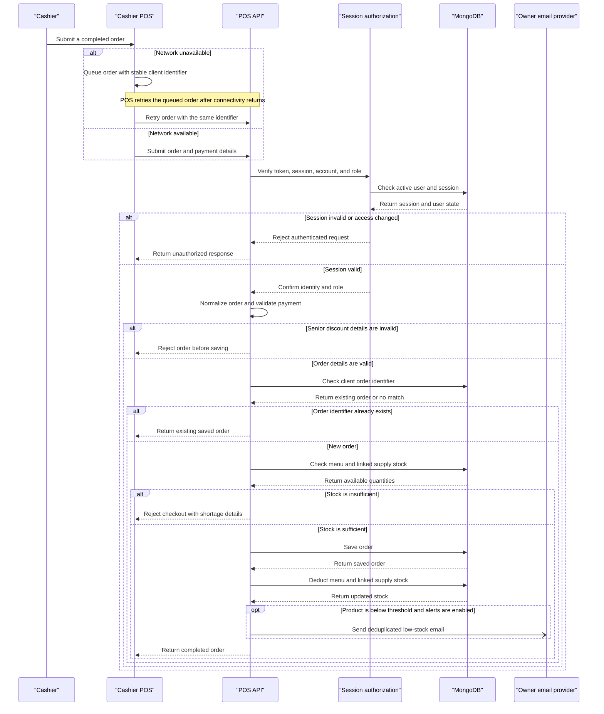

V# Core Business Workflows

Season 3 POS supports café staff from sign-in through order checkout, stock control, and end-of-day sales review. Administrators and managers maintain the menu and supplies, while cashiers record sales and operational events.

## Domain Entities

| Entity | Service / Bounded Context | Description | Key Relationships |
|---|---|---|---|
| User | Identity and Staff | A staff account with an Admin, Manager, or Cashier role and an active or inactive status | Owns login sessions and is attributed to orders and audit events |
| Session | Identity and Staff | A sign-in instance that can be listed, revoked, and expired | Belongs to one user; its token identifier is checked during authenticated requests |
| Order | Sales and Checkout | A receipt and its line items, payment, cashier, and lifecycle status | References menu products by name; affects linked inventory supplies |
| Product | Menu and Availability | A sellable menu item with a category, price, and availability stock | May be linked to one or more inventory supply items |
| Category | Menu and Availability | A named menu grouping maintained independently of products | Groups menu products |
| Inventory Item | Supply and Stock | A raw material or supply balance with restock and usage information | May supply menu products through linked product identifiers and units per sale |
| Waste Item | Waste Management | A record of discarded product or supply with quantity, reason, and cost | May reduce product stock and the linked supply balances |
| Audit Log | Operational Oversight | A record of important account, order, menu, inventory, and waste actions | Attributes an action to the staff member and target record |
| Owner Alert Settings | Reporting and Notifications | Alert recipients, sales target, notification preferences, and deduplication state | Drives low-stock and daily-summary email workflows |

## Service-to-Domain Mapping

The application is a single Express service, not a set of independently deployed microservices. Browser pages call one REST API; business contexts are organized as route groups, frontend modules, and Mongoose models within the same application.

| Service | Domain Context | Owned Entities | External Dependencies |
|---|---|---|---|
| Login and session UI | Identity and Staff | None; client-side session state only | Authentication and session routes |
| Cashier POS | Sales and Checkout | Local in-progress cart and offline order queue | Product, inventory, order, waste, and session routes |
| Admin dashboard modules | Menu, Staff, Stock, Oversight, Reporting | None; presents shared business data | Product, category, user, inventory, waste, audit, insight, and settings routes |
| Express REST API | Shared application boundary | Orchestrates all server-side domain operations | JWT/session authorization and Mongoose models |
| Identity and Staff routes | Identity and Staff | User and Session | MongoDB through Mongoose |
| Sales and Checkout routes | Sales and Checkout | Order | Product, Inventory Item, Audit Log, and Owner Alert Settings |
| Menu and Stock routes | Menu and Supply | Product, Category, Inventory Item | MongoDB through Mongoose |
| Waste and Oversight routes | Waste and Operational Oversight | Waste Item, Audit Log | Product and Inventory Item stock adjustments |
| Insights and Notification routes | Reporting and Notifications | Owner Alert Settings and derived reports | Orders, Products, Inventory Items, Waste Items, and email provider |
| Email adapter | Outbound Notifications | No domain ownership | Resend API or SMTP |

Cross-context exchange occurs through calls inside the Express application and shared MongoDB collections, not service-to-service network calls. MongoDB is the source of truth for users, sessions, menu, sales, inventory, waste, audit history, and alert settings. The cashier browser may hold a pending order locally while offline; a stable client order identifier makes subsequent API retries idempotent.

## Primary Workflows

### Workflow 1: Staff Sign-In and Session Management

1. A staff member submits a username and password from the login page.
2. `POST /api/login` normalizes the username, finds the account, checks its password, and rejects unknown, incorrect, or inactive accounts. Successful legacy plain-text passwords are upgraded to bcrypt hashes.
3. The service records the login, creates a signed JWT and a persisted Session record, then returns the role, username, and token.
4. The browser stores role-appropriate session state and routes Admins and Managers to the admin dashboard or Cashiers to the POS.
5. Protected requests verify the token, confirm the persisted session is not revoked, re-check that the user is active and the role has not changed, then apply endpoint role restrictions.
6. Staff can list their sessions, revoke other sessions or a selected session, change their password, or log out. Password changes revoke other active sessions; logout revokes the current session.

### Workflow 2: Cashier Checkout, Stock Deduction, and Offline Retry

1. The cashier builds an order in the POS and selects a payment method. A Senior discount requires an ID and customer name; G-Cash requires a numeric reference.
2. When offline, the POS saves the pending order locally and retries it when connectivity returns. Retries use the same client order identifier.
3. `POST /api/orders` authenticates the staff member, normalizes the order, recomputes Senior discount amounts from menu categories, and uses the authenticated cashier identity rather than trusting the client.
4. The API first checks the client order identifier. If that order already exists, it returns the existing order rather than creating a duplicate.
5. The API checks available menu stock or, for linked products, the required supply quantities. A shortage rejects the order before it is saved.
6. The API saves the order, then deducts menu and linked supply stock, updates availability, and synchronizes menu availability from supply balances.
7. If a product falls below its low-stock threshold, the service may start a deduplicated owner alert without delaying the checkout response.
8. The POS receives the saved order and completes its local checkout flow.

### Workflow 3: Menu and Supply Maintenance

1. An Admin or Manager creates or edits menu products, categories, and inventory items.
2. A supply item may be linked to menu products with a units-per-sale conversion.
3. Creating, editing, or restocking a linked supply causes the API to recompute the sellable menu stock from available supplies and update the product's availability.
4. Manual restock requires a positive amount; the service updates the supply record and writes an audit event.
5. Cashiers can read menu and inventory availability but cannot perform these management writes.

### Workflow 4: Record Food Waste

1. A staff member submits a waste item, quantity, and reason.
2. The API normalizes the waste entry and checks that its quantity is positive.
3. A Cashier must provide a valid Manager or Admin override; the authenticated cashier remains the recorded actor. Admins and Managers can submit without that override.
4. The service reduces matching menu stock and linked supply balances, synchronizes affected menu availability, then saves the waste record and records an audit event.
5. Only an Admin can delete a waste record; deletion does not reverse the stock change.

### Workflow 5: Void or Refund an Order

1. An authenticated staff member requests a void or refund. Cashiers must provide a Manager or Admin override and may act only on their own orders.
2. The service rejects a missing order, an incompatible current status, an invalid override, or a cashier acting on another cashier's order.
3. For an accepted action, the API restores menu and linked supply quantities, then marks the order Voided or Refunded and records who performed the action.
4. The order remains in history; voided and refunded orders are excluded from completed-sales reporting.

### Workflow 6: Owner Alerts and Daily Summary

1. An Admin configures alert recipients and enables low-stock and daily-summary emails.
2. After checkout, a product below its threshold can trigger a low-stock email, limited to one successful alert per product per Manila date.
3. The daily-summary routine checks settings, builds a report from that day's completed orders and current menu stock, and sends it through the configured provider.
4. Successful sends update deduplication state. Startup performs a catch-up check, and the running process checks periodically.

## Cross-Service Data Flows

There are no separate backend services or gateway aggregation flows. The browser pages send same-origin HTTP requests to Express, which applies authentication and business rules before reading or writing the shared MongoDB database through Mongoose. Reports combine persisted orders, products, inventory, and waste in the application layer.

Sales and stock cross the Menu and Supply contexts through product identifiers and product names. Orders and waste consume linked supply balances; voids and refunds restore them. Inventory edits and restocks recompute associated menu availability. These updates are performed as sequential database operations, not as a cross-service transaction.

The cashier offline queue is the only client-side deferred data flow: pending orders are retried through the same order API with a stable client order identifier. The API returns the already-saved order when it receives a duplicate identifier.

## Business Workflow Sequence

<!-- mermaid-checked: every participant uses `participant Id as "Label"`, no \n in aliases/messages/notes, every alt/opt/loop closed by end, no `:` inside any alias -->

## Business Rules & Decision Logic

- **Identity and authorization:** Usernames are stored in normalized lowercase form and are unique. Only Active users may sign in. Roles are Admin, Manager, and Cashier; each route enforces its allowed roles. A valid JWT alone is insufficient: the persisted session, current user status, and current role must also remain valid.
- **Passwords and sessions:** Passwords use bcrypt after successful migration from a legacy plain-text password. Sessions can be revoked immediately and expire with their JWT; the default JWT lifetime is eight hours.
- **Order validation:** An order must contain at least one item. Cashier attribution comes from the authenticated identity. G-Cash reference numbers must contain digits only. Senior discounts require an ID and customer name, apply at 20 percent to eligible drink items, and are recomputed by the server.
- **Stock availability:** An order is rejected if any tracked menu item or linked supply lacks the required quantity. Linked supply use is quantity multiplied by units per sale. Menu availability follows linked supply balances when supply links exist.
- **Retry safety:** A unique client order identifier prevents duplicate order creation during offline retries. A duplicate returns the previously saved order.
- **Order lifecycle:** Orders remain in history and can transition from completed to Voided or Refunded. Voided orders cannot be voided again; refunded orders cannot be refunded again or voided; voided orders cannot be refunded. Voids and refunds restore menu and linked supply stock.
- **Manager override:** Cashiers must pass a Manager or Admin password/PIN override for voids, refunds, and waste submissions. Cashiers can void or refund only their own orders.
- **Waste and inventory:** Waste quantity must be positive. Recording waste deducts matching menu and linked supply stock. Admins and Managers manage and restock inventory; only Admins can delete waste records.
- **Auditability:** Important actions such as login, logout, order changes, inventory changes, and waste changes generate audit records attributed to the acting user.
- **Owner notifications:** Low-stock messages are sent only when alerts are configured, enabled, have recipients, and have not already succeeded for that item on the current Manila date. Daily summaries include completed sales and low-stock products and are deduplicated by Manila date. The saved daily-summary hour is present in settings; the current scheduler checks on startup and periodically but does not gate sending on that hour.
- **Consistency boundary:** Multi-record workflows such as order creation, stock deduction, waste recording, void, and refund use sequential MongoDB operations without an explicit transaction. The implementation saves an order before applying stock deductions, and applies waste stock deductions before saving the waste record; an intermediate database failure can therefore leave partially applied state.
